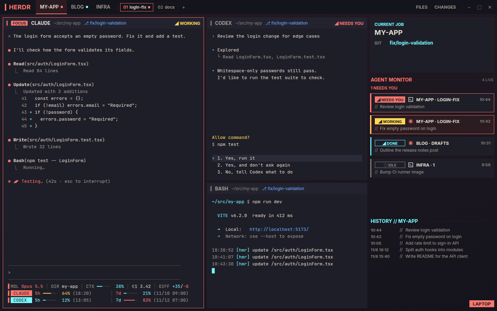
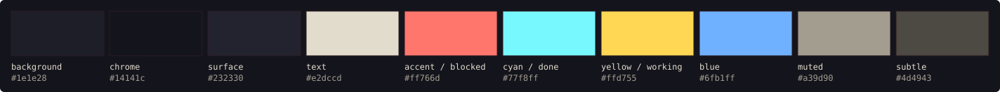

# yp-Cyberpunk-hud

[English](README.md) | 日本語



<sub>見本のデータで描いた再現画面です。寸法と色はこのリポジトリのファイルと同じです。左下のステータスラインは作者が使っているもので、このリポジトリには入っていません。</sub>

[herdr](https://herdr.dev) 用の HUD 風ダークテーマ一式です。herdr のレイアウトと配色テーマ、Claude Code の配色テーマが入っています。どれも同じ配色を使います。

作者が自分用に作ったものなので、整っていない所もあります。好みに合わせて自由に手を入れてください。

Cyberpunk 2077 のゲーム内 HUD にインスパイアされて作りました。ファンが作った非公式の設定です。CD PROJEKT とは関係がなく、承認も受けていません。ゲームの素材は含みません。

## 入っているもの

| フォルダー | 中身 | 置き場所 |
|---|---|---|
| `yp-cyberpunk/` | herdr のレイアウト「yp-cyberpunk」と、それが使う mod 5本 | `~/.config/herdr-app/layouts/`、`~/.config/herdr-app/mods/` |
| `themes/herdr/` | herdr の配色テーマ | `~/.config/herdr-app/themes/` |
| `themes/claude-code/` | Claude Code のカスタムテーマ | `~/.claude/themes/` |

## 配色



赤は「あなたの操作待ち」、シアンは「完了・平常」、黄は「作業中」を表します。

## herdr レイアウト: yp-cyberpunk

上端のバーには space（作業場所のまとまり）のタブと表示中の space のタブ、Files / Changes パネルの切り替えボタンが並びます。左側には端末が並びます。各ペインの見出しにはプログラム名・フォルダー・ブランチと、`◢ WORKING` / `◢ NEEDS YOU` / `◢ DONE` の状態ラベルが出ます。右側にはフォーカス中の端末のプロジェクトとブランチが出ます。全エージェントの一覧（操作待ちのものが先頭）とマシン名も表示されます。

### 入れ方

herdr の中で動いているエージェントに、このリポジトリの URL を渡して「このレイアウトを入れて」と頼むのがいちばん安全です。herdr 同梱の手引き（`~/.config/herdr-app/AGENTS.md`）には、他人のレイアウトを入れるときは同じ名前のファイルを上書きせず、新しい側を改名する手順が書かれています。

手で入れる場合は、先に同じ名前のファイルがないか確かめます。

```sh
ls -d ~/.config/herdr-app/layouts/yp-cyberpunk.* ~/.config/herdr-app/mods/yp-cyberpunk-* 2>/dev/null
```

何も表示されなければ、コピーして切り替えます（Linux の herdr-app 0.1.13 で確認）。`-n` を付けているので、既存のファイルは上書きされません。

```sh
cp -n yp-cyberpunk/layouts/yp-cyberpunk.json yp-cyberpunk/layouts/yp-cyberpunk.svg ~/.config/herdr-app/layouts/
cp -rn yp-cyberpunk/mods/yp-cyberpunk-* ~/.config/herdr-app/mods/
herdr-app do layout.switch --name yp-cyberpunk
```

ファイル名が表示されたら、その名前はもう使われています。コピーせず、エージェントに頼んでください。手で改名するときは、ファイルやフォルダーの名前と、`yp-cyberpunk.json` の中の `"mod"` の名前をそろえて変えます。

`ctrl-shift-l` で元のレイアウトに戻せます。入れたファイルを消せば、レイアウトもなくなります。組み立ての詳しい説明は [yp-cyberpunk/RECIPE.md](yp-cyberpunk/RECIPE.md)（英語）にあります。

mod が触るもの: `yp-cyberpunk-machine` は表示中の space のマシン名を出します。ローカルの space では `hostname` を1回実行し、このパソコンの名前を出します。`yp-cyberpunk-monitor` は過去のエージェントの題名（300件・90日まで）と各エージェントの状態が最後に変わった時刻を、mod 自身の保存領域に残します。ネットワークを使う mod はありません。

## テーマ

レイアウトと同じく、先に同じ名前のテーマがないか確かめてから、`-n` 付きでコピーします。

```sh
ls ~/.config/herdr-app/themes/cyberpunk-hud.json ~/.claude/themes/cyberpunk-hud.json 2>/dev/null
cp -n themes/herdr/cyberpunk-hud.json ~/.config/herdr-app/themes/
cp -n themes/claude-code/cyberpunk-hud.json ~/.claude/themes/
```

herdr では、`~/.config/herdr-app/settings.json` の `"theme"` の値を `"cyberpunk-hud"` にします。

Claude Code では、`~/.claude/settings.json` の `"theme"` の値を `"custom:cyberpunk-hud"` にします。

どちらも、`"theme"` の項目がなければ外側の `{ }` の中に1行足します。ファイルがなければ、`{ "theme": "cyberpunk-hud" }` のように `{ }` で囲んで作ります。

## ライセンス

[MIT](LICENSE)
