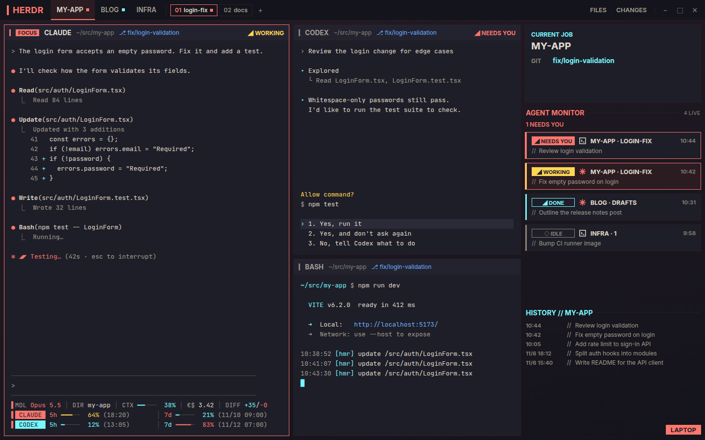
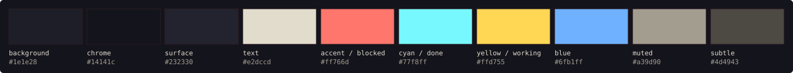

# yp-Cyberpunk-hud

English | [日本語](README.ja.md)



<sub>A mockup drawn with sample data, using the same sizes and colors as the files in this repo. The status line at the bottom left is the author's own and is not included here.</sub>

A HUD-style dark theme set for [herdr](https://herdr.dev): a herdr layout and color themes for herdr and Claude Code, all sharing one palette.

This started as the author's personal setup and is rough in places. Feel free to customize it however you like.

Inspired by the in-game HUD of Cyberpunk 2077. This is an unofficial, fan-made setup and is not affiliated with or endorsed by CD PROJEKT. It contains no game assets.

## What's inside

| Folder | What it is | Where it goes |
|---|---|---|
| `yp-cyberpunk/` | herdr layout "yp-cyberpunk" and the 5 mods it uses | `~/.config/herdr-app/layouts/`, `~/.config/herdr-app/mods/` |
| `themes/herdr/` | herdr color theme | `~/.config/herdr-app/themes/` |
| `themes/claude-code/` | Claude Code custom theme | `~/.claude/themes/` |

## The palette



Red marks what needs you, cyan marks what is done or calm, yellow marks work in progress.

## herdr layout: yp-cyberpunk

A top bar with your spaces as tabs, the active space's tabs and the Files / Changes toggles. Terminals sit on the left with a HUD strip on each pane (program, folder, branch, and a `◢ WORKING` / `◢ NEEDS YOU` / `◢ DONE` label). On the right: the focused terminal's project and branch, an agent monitor that lists every agent with the ones waiting on you first, and the machine name.

### Install

The safest way is to give this repo's URL to an agent running in herdr and ask it to add the layout. herdr's bundled guide (`~/.config/herdr-app/AGENTS.md`) tells agents never to overwrite a layout or mod with the same name, and to rename the new one instead.

To install by hand, first check that none of the names are taken:

```sh
ls -d ~/.config/herdr-app/layouts/yp-cyberpunk.* ~/.config/herdr-app/mods/yp-cyberpunk-* 2>/dev/null
```

If that prints nothing, copy and switch (tested with herdr-app 0.1.13 on Linux). `-n` keeps any existing file from being overwritten.

```sh
cp -n yp-cyberpunk/layouts/yp-cyberpunk.json yp-cyberpunk/layouts/yp-cyberpunk.svg ~/.config/herdr-app/layouts/
cp -rn yp-cyberpunk/mods/yp-cyberpunk-* ~/.config/herdr-app/mods/
herdr-app do layout.switch --name yp-cyberpunk
```

If it prints any file, that name is already in use. Don't copy; ask an agent instead. To rename by hand, change the file and folder names and the `"mod"` names in `yp-cyberpunk.json` together.

`ctrl-shift-l` switches back to your previous layout, and deleting the copied files removes it. The full build brief is in [yp-cyberpunk/RECIPE.md](yp-cyberpunk/RECIPE.md).

What the mods touch: `yp-cyberpunk-machine` shows the active space's machine, and for a local space runs `hostname` once to show this computer's name. `yp-cyberpunk-monitor` keeps past agent titles (up to 300, for 90 days) and when each agent's state last changed in its own storage. No mod uses the network.

## Themes

As with the layout, check for a theme with the same name first, then copy with `-n`:

```sh
ls ~/.config/herdr-app/themes/cyberpunk-hud.json ~/.claude/themes/cyberpunk-hud.json 2>/dev/null
cp -n themes/herdr/cyberpunk-hud.json ~/.config/herdr-app/themes/
cp -n themes/claude-code/cyberpunk-hud.json ~/.claude/themes/
```

herdr: set `"theme"` to `"cyberpunk-hud"` in `~/.config/herdr-app/settings.json`.

Claude Code: set `"theme"` to `"custom:cyberpunk-hud"` in `~/.claude/settings.json`.

If the file has no `"theme"` entry, add it as one line inside the outer `{ }`. If the file doesn't exist, create it with the braces, like `{ "theme": "cyberpunk-hud" }`.

## License

[MIT](LICENSE)
